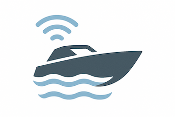

  

<h3 align="center">Connected monitoring for your boat</h3>

  <a href="https://domobateau.fr">domobateau.fr</a>

DomoBateau is a French company that designs and operates a connected monitoring platform for boats: remote monitoring, real-time alerts and centralised management of onboard equipment, for boat owners and marine professionals.

- **Remote monitoring:** see your boat's status from any connected device.
- **Alerts:** be notified about batteries, bilge pumps, position and more.
- **Maintenance:** event history and service reminders, all in one place.
- **Fleets:** one dashboard for one boat or many.

---

**FR** — DomoBateau est une société française qui conçoit et exploite une plateforme de supervision connectée pour bateaux : supervision à distance, alertes en temps réel et gestion centralisée des équipements à bord, pour les propriétaires et les professionnels du nautisme. Plus d'informations sur [domobateau.fr](https://domobateau.fr).
